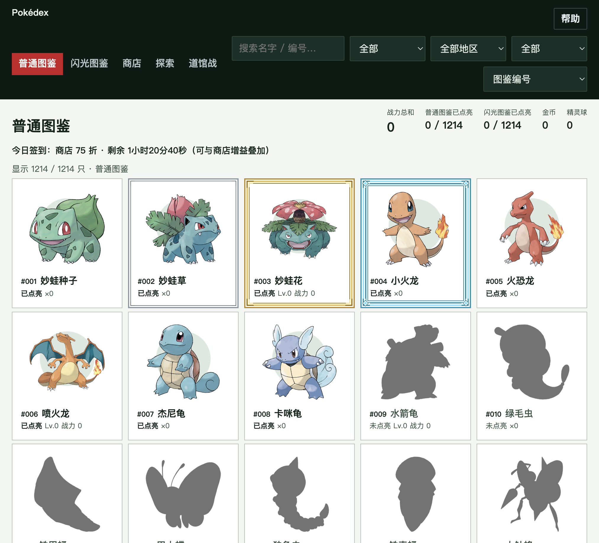

# 宝可梦图鉴

> 一本自己点亮的本地图鉴：普通和闪光各一本，键盘活动换成精灵球，十个地区打道馆，当天打赢小智后图鉴会落花。

<p align="center">
  
</p>

**角色**：产品 / 界面 / macOS 与 Windows 客户端  
**形态**：本地桌面应用。Mac 用系统 WebView，Windows 用本机 Edge 开一个应用窗口。  
**栈**：HTML · CSS · JavaScript · Python 本地服务 · Swift · C（Windows 启动器）

---

## 作品集摘要

| 维度 | 说明 |
|------|------|
| 问题 | 图鉴、抓捕、进化、商店和道馆散在不同页面里，进度还要跟这台电脑的按键绑在一起 |
| 方案 | 一个本地目录收齐两本图鉴和道馆；按键计数留在本机，空存档不会盖掉已有进度 |
| 我的工作 | ① Mac 与 Windows 都能离线打开 ② 目录、边框和筛选做成同一套界面 ③ 打包成可下载的 zip |
| 亮点 | 未点亮是剪影；点亮后才有底圆。边框从灰到银、金、钻石逐级加线脚 |

---

## 产品怎么跑

```text
打开图鉴
    ↓
键盘、鼠标按键或滚轮算活动（移动不算）
    ↓
每 10 秒里有过活动，就获得 10 个精灵球
    ↓
探索里选地区再投球；集满 3 只同一颜色会自动进化
    ↓
最终形态升级，并换成金币
    ↓
金币买增益、升级，或解锁超级进化和特殊形态
    ↓
十个地区打道馆；普通版通关后解锁更高一级
    ↓
十个地区的高级冠军都打完后，可以挑战小智
    ↓
他的阵容每个自然日更换；当天打赢后，回到图鉴会落花，直到这天结束
```

目录一共 1214 条：全国图鉴，加上地区形态、超级进化和特殊形态。普通和闪光各记一本。

---

## 架构一览

```text
┌──────────────────────────────────────────┐
│  Mac：宝可梦图鉴.app（WKWebView）          │
│  Windows：宝可梦图鉴.exe → 本机 Edge       │
└──────────────────┬───────────────────────┘
                   │ 127.0.0.1
┌──────────────────▼───────────────────────┐
│  serve_pokedex.py / Windows 启动器        │
│  图鉴页面 · data/ · progress.json         │
│  按键计数与存档合并                        │
└──────────────────────────────────────────┘
```

页面在 `pokedex/`。精灵、道馆和地区数据在 `data/`。进度不进仓库：Mac 写在 `~/Library/Application Support/PokemonPokedex/progress.json`，Windows 写在 `%LOCALAPPDATA%\PokemonPokedex\progress.json`。

导入会整份替换当前存档。还在飞的旧写入带不上一代版本号，不会把刚清掉的道馆进度再合并回来。空文件也不会盖掉一份已经有进度的存档。

---

## 界面

顶栏同一行放图鉴切换，以及战力总和、两本图鉴的点亮数、金币和精灵球。筛选紧挨在下面：名字、收集状态、地区、神兽、排序。

卡片未点亮时是剪影，名字和编号仍在。点亮后换上形象和底圆。打赢普通冠军，该地区已点亮的精灵加上银色边框；高级冠军换成金色；打赢该地区的主角后换成钻石。同一只在两个地区都有时，边框只发一次。

---

## 下载

到 [Releases](https://github.com/hahadada0528/pokemon/releases) 下载对应压缩包：

| 系统 | 文件 |
| --- | --- |
| macOS | `pokedex-mac.zip` |
| Windows | `pokedex-win.zip` |

### macOS

解压后打开 `宝可梦图鉴.app`。

如果系统提示无法打开，在 Finder 里按住 Control 再点这个应用，选择「打开」。按键计数需要在「系统设置 → 隐私与安全性 → 输入监视」里允许它。球数不增加时，把这项关掉再打开一次。

### Windows

解压后保留整个文件夹，双击里面的 `宝可梦图鉴.exe`。不要把 exe 单独挪走，它要读取旁边的 `pokedex` 和 `data`。本机需要已安装 Microsoft Edge。

关掉窗口以后，托盘图标还在，按键仍会计数。要退出时，在托盘图标上选择退出。

## 存档

商店里可以导出、导入。空存档不会覆盖一份已经有进度的存档。按键获得的精灵球跟这台电脑绑定，换电脑时用导出和导入。

---

## 仓库结构

```text
├── pokedex/                  # 图鉴页面（HTML / CSS / JS）
├── data/                     # 精灵、道馆、训练家图片
├── scripts/serve_pokedex.py  # 本地服务、按键计数、存档合并
├── scripts/pokemon_app.swift # Mac WebView 外壳
├── packaging/windows/        # Windows 启动器（C）
└── assets/pokedex.png        # 作品集封面
```

---

## 许可与声明

本仓库用于作品集展示与本机运行。宝可梦名称、形象与相关设定归其权利人所有，此处不表示任何官方授权。
